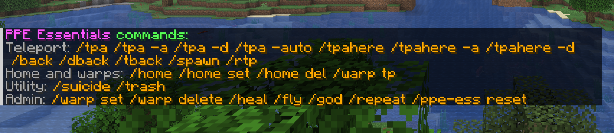

# PPE Essentials

[](https://modrinth.com/mod/ppe-essentials) [](https://www.curseforge.com/minecraft/mc-mods/ppe-essentials) [](https://github.com/PurpleEastZQ/ppe-essentials)

PPE Essentials is a lightweight mod that adds useful commands (like /tpa /repeat) and tweaks, with highly configurable options

[](https://github.com/PurpleEastZQ/ppe-essentials/blob/master/artwork/ppe-essentials-help-preview.png)

## Features

- Server-side only mod (Can still be installed on your client for singleplayer use)
- Configurable command toggles, permission levels and more
- Configurable protection against creeper, enderman, and ravager block damage
- Ready out of the box; Fabric only requires Fabric API
- Polished messages with clickable buttons, titles, and sounds
- Player-selection menus for `/tpa` and `/tpahere` when no target is provided
- Multilingual support with automatic client language detection and a configurable `fallbackLanguage`
- Persistent player data for homes, warps, back locations, fly, god mode, and notice triggers

## Supported Versions

- NeoForge / Fabric 1.21.1, 26.1.2, 26.2, 26.3

## Commands

Run `/ppe-ess help` to see the command list and availability. Use Tab completion for subcommands, arguments, and quoted warp names

## Configuration

Edit `config/ppe_essentials-common.toml` to configure the mod

## Building

Fabric version also require Fabric API

To build all supported versions from source using JDK 25:

```powershell
.\build-all-versions.ps1
```

To build a single target:

```powershell
.\gradlew.bat buildNeoForge --no-daemon --no-configuration-cache
.\gradlew.bat buildFabric "-Ptarget_minecraft_version=26.3" --no-daemon --no-configuration-cache
```
